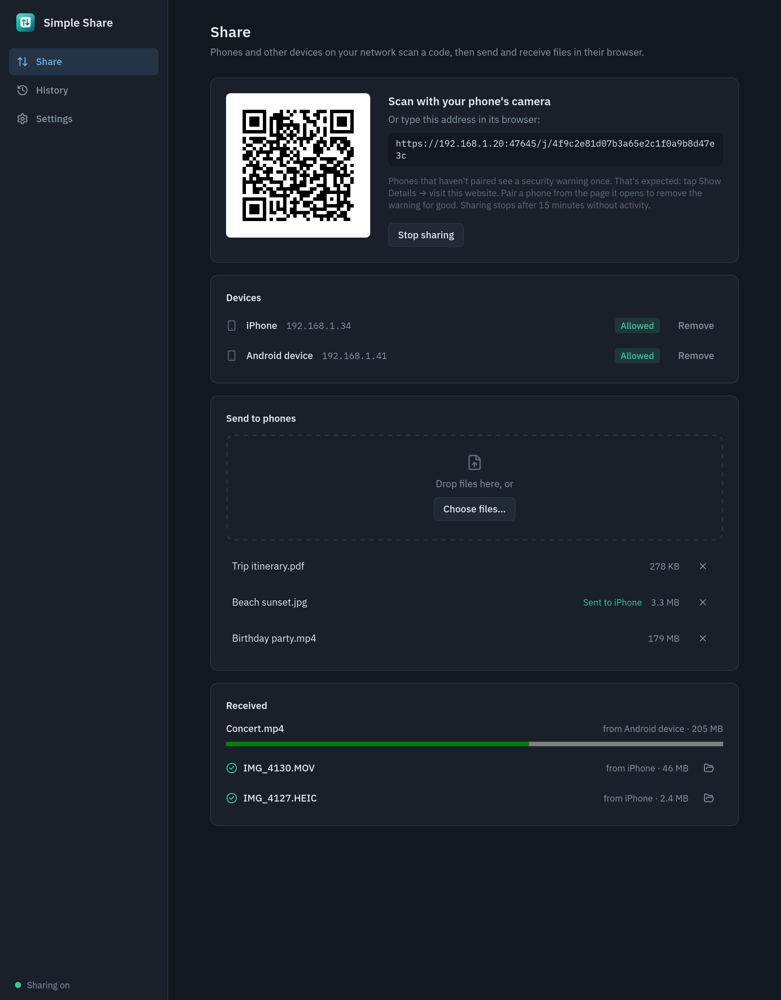
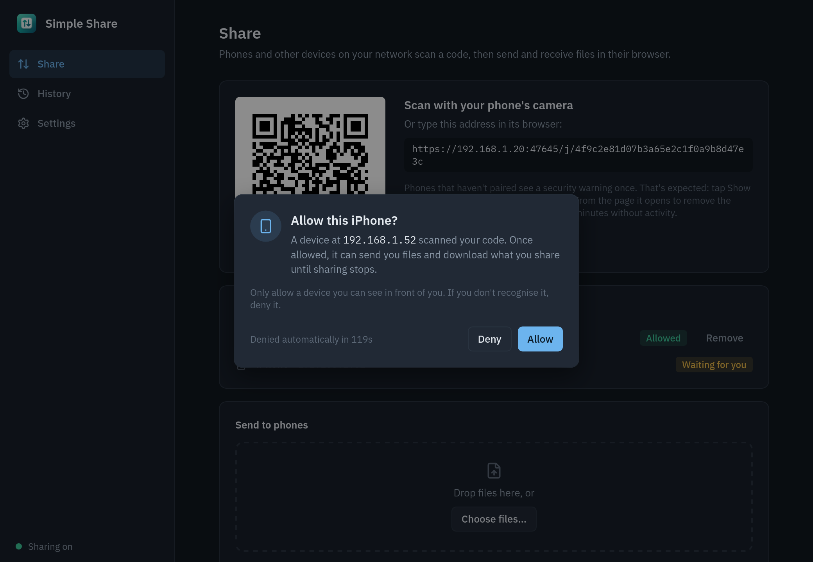
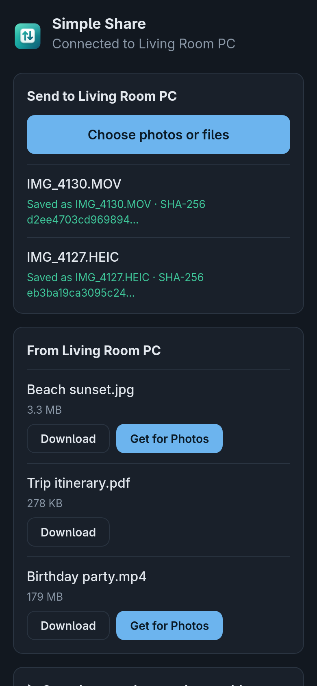
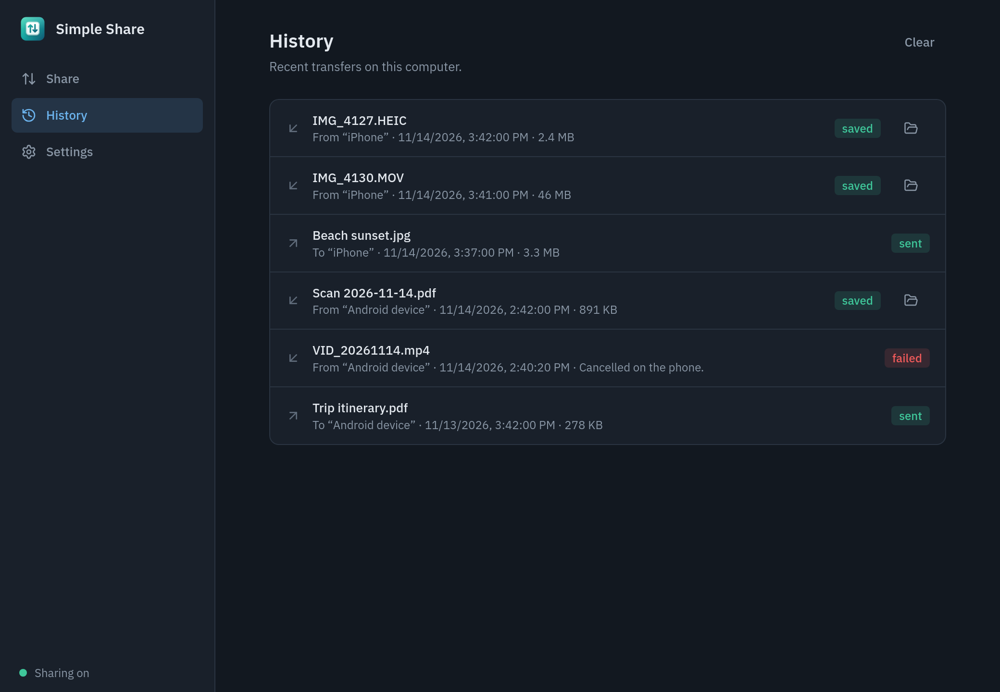
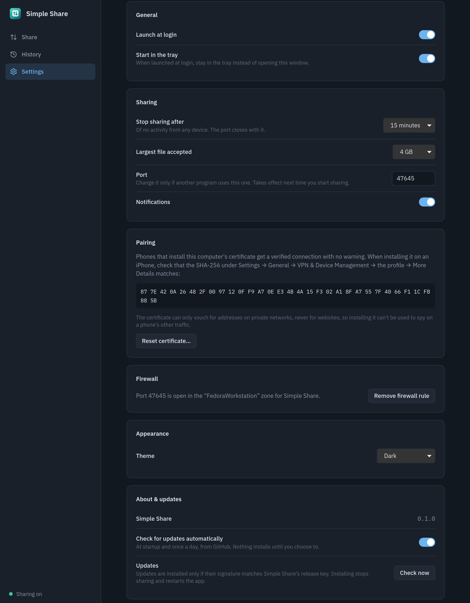

# Simple Share

Send photos, videos and files between your computer and any phone, tablet or other
computer on the same Wi-Fi. The phone needs only its camera and browser: no app to
install, no account, no cloud service, no cable. Part of Simple Suite.



## What it does

* **Phone → computer.** Pick photos, videos or any files on the phone. They land in a
  folder on the computer (Downloads by default), never overwriting anything.
* **Computer → phone.** Drop files onto Simple Share. Phones can download them, and
  photos and videos can go straight into the iPhone's Photos app.
* **Works with anything that has a browser:** iPhone, iPad, Android, Chromebooks, and
  other Windows, Mac or Linux computers.
* **Only devices you allow.** Every phone that scans the code must be allowed on the
  computer first. Access ends when you stop sharing.
* **Private and encrypted.** Files go directly between the two devices over HTTPS
  and never leave your network.
* **Lives in the tray** (the menu bar on macOS), keeps itself up to date, and runs on
  Windows, macOS and Linux.

## How it works

1. Click **Start sharing** on the computer. A QR code appears.
2. Scan it with the phone's camera and open the link.
3. The computer asks **Allow this iPhone?** Check it's your phone and click **Allow**.
4. Send and receive. The phone stays allowed until sharing stops, either when you click
   **Stop sharing** or automatically after 15 minutes without activity.

| The computer asks first | On the phone |
|---|---|
|  |  |

The first time, the phone's browser warns that the connection "is not private". That's
expected for devices on a home network. The connection is still encrypted. Tap **Show
Details → visit this website** (Safari) or **Advanced → Proceed** (Chrome).

To make the warning go away for good, pair the phone once. On the phone page, open
**Stop the security warning on this device** and follow the steps. On an iPhone:

1. Tap **Download certificate**, then **Allow** and **Close**.
2. Open Settings → **Profile Downloaded** → **Install**.
3. Settings → General → About → **Certificate Trust Settings** → turn on **Simple Share
   local certificate**.
4. Optional check: under Settings → General → VPN & Device Management → the profile →
   More Details, the SHA-256 should match the one in Simple Share's Settings → Pairing.

## Install

Download the right file for your computer from the
[latest release](https://github.com/fleetwoodjohnr/simple-share/releases/latest).
Use `x64` / `x86_64` / `amd64` for most PCs and Intel Macs, and `arm64` / `aarch64`
for Apple Silicon Macs and ARM PCs.

| System | File | Requirements |
|---|---|---|
| Windows | `…_x64-setup.exe` or `…_arm64-setup.exe` | Windows 10 22H2 or 11 |
| macOS | `…_aarch64.dmg` (Apple Silicon) or `…_x64.dmg` (Intel) | macOS 13 or later |
| Ubuntu, Debian, Mint | `…_amd64.deb` or `…_arm64.deb` | Ubuntu 22.04+ / Debian 12+ |
| Fedora and other RPM systems | `…x86_64.rpm` or `…aarch64.rpm` | Fedora 38+ |
| Any other Linux | `…AppImage` | WebKitGTK 4.1 |

**Windows.** Run the setup file. It installs just for you, with no admin rights needed.
Simple Share isn't signed with a paid Microsoft certificate, so SmartScreen may say
"Windows protected your PC". Click **More info → Run anyway**. The first time you start
sharing, allow Simple Share through Windows Firewall on **Private networks**.

**macOS.** Open the DMG and drag Simple Share to Applications. It isn't notarised by
Apple, so the first launch is blocked. Open **System Settings → Privacy & Security**,
scroll down and click **Open Anyway**. If the macOS firewall is on and asks whether
Simple Share may accept incoming connections, click **Allow**.

**Linux.** From the folder you downloaded to:

```sh
sudo apt install ./*Simple.Share_*_amd64.deb     # Ubuntu, Debian, Mint
sudo dnf install ./*Simple.Share-*.x86_64.rpm    # Fedora
chmod +x ./*Simple.Share_*.AppImage && ./*Simple.Share_*.AppImage   # anything else
```

On Fedora and other systems that use firewalld, Simple Share shows **Allow** when the
firewall would block phones. One password prompt opens only its single port, and
Settings → Firewall removes the rule again. GNOME shows tray icons only with the
*AppIndicator and KStatusNotifierItem Support* extension. Ubuntu includes it; on Fedora,
install `gnome-shell-extension-appindicator`. Without a tray, closing the window quits
the app.

### Updates

Simple Share checks this repository's releases at startup and once a day. When a new
version is available it tells you, and installs only when you click **Install and
restart**. Every update must carry a valid signature from Simple Share's release key,
or it is refused. You can turn automatic checks off, or check now, in Settings → About &
updates. After the first install, updates don't show the Windows or macOS prompts
again. On Linux, deb and rpm updates ask for your password.

## Screenshots

| History | Settings |
|---|---|
|  |  |

## Security

* **Encrypted, always.** Every connection is HTTPS (TLS 1.2/1.3).
* **Verified once paired.** Paired phones get a verified connection with no warning, so
  nobody else on the network can intercept or alter transfers. The certificate is
  *name-constrained*: it can only vouch for private network addresses, never for a
  website, so installing it can't be used to spy on the phone's other traffic. The
  phone enforces this, and tests cover it.
* **Nothing without your OK.** The QR code holds a one-time secret for this session.
  Each device that uses it must then be allowed on the computer, and is denied
  automatically after 2 minutes. Stopping sharing ends every device's access.
* **Hardened server.** Exact Host check (no DNS rebinding), a CSRF header on uploads,
  no CORS, a strict Content-Security-Policy, no-referrer and no-store.
* **Safe saving.** File names are reduced to a safe bare name, and nothing is ever
  overwritten: you get `photo (1).jpg` instead. Uploads stream to a hidden temp file,
  are synced to disk, and only then are reported as saved, with their SHA-256 on both
  screens. Incomplete or oversized uploads leave nothing behind.
* **Only what you choose.** Phones can download only the files you added, by a random
  ID.
* **Closed when idle.** Nothing listens until you start, and sharing stops itself after
  15 minutes without activity.
* No accounts, no telemetry. The only connection to the internet is the update check.

## Limits

* Both devices must be on the same network. Guest or hotel Wi-Fi with "client
  isolation" blocks devices from reaching each other.
* Unpaired phones see the browser's warning once per session. Pairing removes it.
* iOS may convert HEIC photos to JPEG when picking them from the photo library.

## Build from source

You need Rust 1.90+, Node 20+, and the
[Tauri prerequisites](https://v2.tauri.app/start/prerequisites/) for your system.

```sh
npm install
npm run tauri dev      # run
npm run tauri build    # packages: deb/rpm/AppImage, NSIS, DMG
cargo test --workspace # security and protocol tests
```

### Releasing

Push a tag `vX.Y.Z` that matches the version in `package.json`, `Cargo.toml` and
`src-tauri/tauri.conf.json`. GitHub Actions builds Windows, macOS and Linux (x64 and
ARM64), verifies every signature, and publishes the release with `latest.json`. The
signing key lives in `.release-keys/`, which is never committed, and in the repository
secrets `TAURI_SIGNING_PRIVATE_KEY` and `TAURI_SIGNING_PRIVATE_KEY_PASSWORD`. Keep a
backup of `.release-keys/`: without it, installed copies can never be updated.

## License

MIT OR Apache-2.0.
